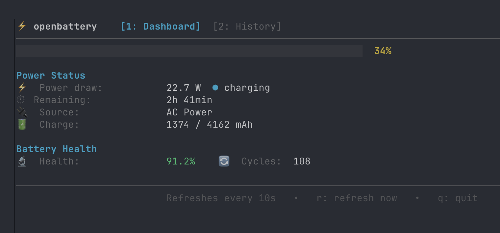

# ⚡ openbattery

[](https://github.com/przybylku/openbattery/actions/workflows/ci.yml)
[](go.mod)
[](https://github.com/przybylku/openbattery/releases)
[](LICENSE)

A beautiful, responsive **macOS** terminal battery monitor built with [Bubble Tea](https://github.com/charmbracelet/bubbletea).

Watch your battery level, power draw, discharge estimates, and health stats in real time — right from your terminal.



## Features

- **Live dashboard** — battery percentage with gradient progress bar, power draw (watts), remaining time, and charge estimates
- **History sparkline** — ▁▂▃▄▅▆▇█ chart of battery level over time with Y-axis labels and time range
- **Smart estimates** — remaining time calculated from your average power consumption (last hour / today, discharging samples only)
- **Time to full** — estimated charging completion time while plugged in
- **Battery health** — current max capacity vs design capacity, cycle count
- **Scriptable** — `--json` prints a one-shot battery snapshot for scripts, bars and automations
- **Two tabs** — `1` for dashboard, `2` for history, `r` to refresh, `q` to quit
- **Responsive layout** — adapts seamlessly to any terminal size
- **Persistent history** — saves up to 500 samples to `~/.openbattery/history.json`
- **Zero config** — just run it, no setup needed

## Installation

### Homebrew (recommended)

```bash
brew tap przybylku/openbattery
brew install przybylku/openbattery/openbattery
```

### Go install

```bash
go install github.com/przybylku/openbattery@latest
```

### Build from source

```bash
git clone https://github.com/przybylku/openbattery.git
cd openbattery
go build -o openbattery .
./openbattery
```

Requires **macOS** (uses `pmset` and `ioreg` system utilities).

## Data Sources

`openbattery` reads from two macOS system commands:

- **`pmset -g batt`** — battery percentage, charge status, Apple's time estimate
- **`ioreg -rn AppleSmartBattery`** — amperage (mA), voltage (mV), capacities (mAh), cycle count

All data is processed into a clean TUI with color-coded indicators:

| Condition | Color |
|-----------|-------|
| Battery ≥ 50% | Green |
| Battery ≥ 20% | Yellow |
| Battery < 20% | Red |
| Charging | Cyan |
| Charged | Green |

## Scripting

`openbattery --json` prints a single snapshot and exits — no TUI needed:

```bash
openbattery --json
openbattery --json | jq '.percent'
```

```json
{
  "time": "2026-11-16T12:05:34+01:00",
  "percent": 93,
  "status": "discharging",
  "watts": 6.89,
  "remaining_time": "8h 53min",
  "estimated_hours_left": 6.56,
  "current_capacity_mah": 3577,
  "max_capacity_mah": 4043,
  "design_capacity_mah": 4563,
  "cycle_count": 158,
  "health_percent": 88.6
}
```

`openbattery --version` prints the build version.

## History

Every 10 seconds, a data point is appended to `~/.openbattery/history.json` (keeps last 500 entries). The history tab renders a sparkline of the last 60 samples with the most recent 10 displayed in a table.

## License

MIT
